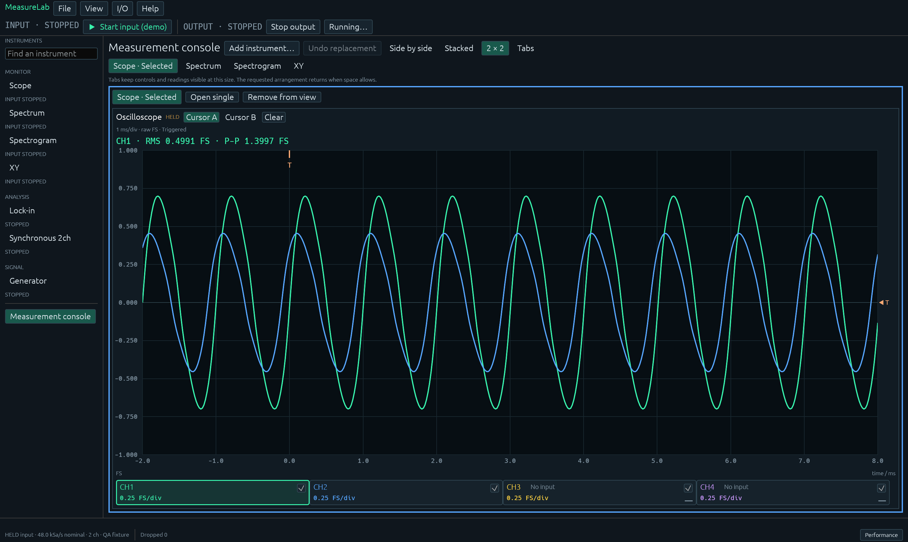
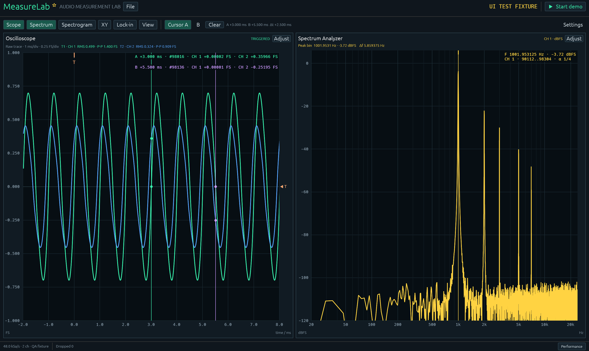
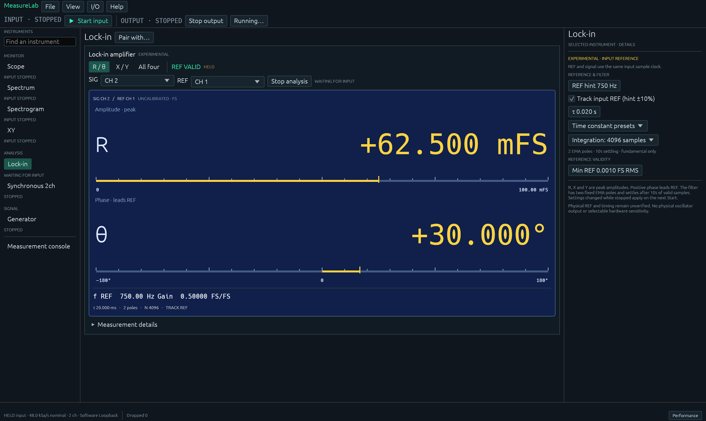

# MeasureLab — Audio Measurement Lab

[English](README.md)

[](https://github.com/youtube-at-vach/MeasureLab/actions/workflows/ci.yml?query=branch%3Amain)
[](Cargo.toml)
[](guide/rust/PLAN.md)
[](LICENSE)
[](https://securityscorecards.dev/viewer/?uri=github.com/youtube-at-vach/MeasureLab)

**正確な測定を、無料で、すべての人へ。**

PCとオーディオインターフェースを、信号を探究する測定ラボに。波形を見る。スペクトルを調べる。周波数の変化を追う。2つのチャンネルの関係を確かめる。その一連の作業を、ひとつのワークスペースで。

**MeasureLabの新しい開発が始まりました。Rustプロトタイプが、ついに`main`に入りました。** 測定条件と結果の再現性、応答性のある操作、GPUによる描画を土台に、オーディオ測定ツールを作り直しています。Scope・Spectrum・Spectrogram・XYはすでに動作し、実験段階のLock-inも形になってきました。今すぐソースから試し、次の版 **v0.10.0** を一緒に育てていけます。

[](https://youtube-at-vach.github.io/MeasureLab/rust/)
[](#プロトタイプを試す)
[](guide/rust/PLAN.md)

[](.github/assets/readme/rust-workspace.png)

*現在のRustワークスペース。信号を4つの視点で眺め、測定に集中できます。画面はQA用の合成信号で撮影し、スペクトログラムのオレンジ色の帯は意図的な入力欠落を示しています。各画像をクリックすると原寸で表示できます。*

## 測定を深める、新しい土台

- **信号をいろいろな角度から。** 時間・周波数・時間と周波数・XYの表示を切り替えたり、ScopeとSpectrumに絞って観察したりできます。1〜16chの入力から、必要なチャンネルを選べます。
- **表示を変えても、解析は続く。** オーディオ取得・測定ワーカー・GPU描画を分離しています。表示を切り替えたり閉じたりしても、解析と平均処理は続きます。
- **画像の先まで、結果を残す。** 捕捉した信号を保持し、設定と結果を保存。参照結果を読み込んで比較できます。CH校正・単位・取得条件も結果に対応付けて保存します。
- **機器なしでも、まず触れる。** Software Loopbackで、既知のゲイン・位相・遅延・雑音を共通入力経路から観察できます。通常ビルドで使え、物理的な音声出力は行いません。

## 現在使える機能

| 測定器・機能 | Rustプロトタイプの実装範囲 |
| --- | --- |
| オーディオ入力 | CPALによる1〜16ch同期入力、対応する公称サンプルレートの選択 |
| Scope | 任意2ch、Auto／Normal／Singleトリガー、Autoset、RMS・Peak・P-P、時間カーソルと取得保持 |
| Spectrum | 1,024〜524,288点FFT、振幅／PSD、帯域電力・RMS、平均、ピーク保持、周波数カーソル |
| Spectrogram | 周波数成分の時間変化を表示する独立STFT、入力欠落の表示 |
| XY / Lissajous | 任意の同期2chを割り当てるXY表示 |
| 校正・結果の再利用 | CHごとのゲイン・オフセット・単位、版付き設定、Scope／SpectrumのJSON・CSV・PNG、参照比較 |
| Software Loopback | 既知信号と仮想DUTによるゲイン・位相・遅延・雑音の観察 |
| 実験段階のLock-in | 基本波のREF／応答測定、X/Y・R/θ、Gainと整定状態 |

取得後の測定コアは **f64** を基準にします。選択可能なf32 FFTは数値上の制限を分けて扱います。結果には取得条件を対応付け、欠落や無効な値を正常なゼロで代用しません。

## もう少し、画面を見てみる

| Scope + Spectrum | 実験段階のLock-in |
| --- | --- |
| [](.github/assets/readme/rust-scope-spectrum.png) | [](.github/assets/readme/rust-lockin.png) |
| 波形と周波数成分を並べて観察。数値とカーソルをプロット内で確認できます。 | REFを使った振幅・位相測定を、専用のR/θ・X/Y表示で試せます。 |

*現行RustのQAビルドで撮影。Scope／Spectrumは合成信号、Lock-inはSoftware Loopbackを使っています。操作画面の紹介であり、物理デバイスの精度を示す画像ではありません。*

## これからのMeasureLab

次の目標は、入力から結果の保存まで、安心して使える小さなオーディオ測定ラボを仕上げることです。[実装計画](guide/rust/PLAN.md) は、その土台から段階的に広げていきます。

1. **基礎測定器を仕上げる。** 2chのScope／Spectrumの測定手順を磨き、校正・長時間動作・実機・実験段階のLock-inを評価します。
2. **チャンネル同士の関係を測る。** 同期入力をもとに、クロススペクトル・位相・遅延の測定へ進みます。
3. **励振から応答まで、ひとつの測定に。** 物理信号出力と応答測定を導入し、その先で歪み・インパルス応答・サンプル時計の校正などを検討します。

これらは開発の方向性で、後続機能はまだ使えません。まずは正確さ・再現性・実用的な2ch測定を優先し、1〜16chの入力基盤を維持して育てます。

> [!NOTE]
> **現在はソースから試せるプロトタイプです。** 実機精度・長時間動作・OSや機器の対応には未確認の範囲があります。[検証記録](guide/rust/validation/README.md) を参照してください。通常Generatorの音声出力は実験段階です。THD／FRF／IR、VST3、出力校正、実サンプル時計の校正はRust版では未実装です。Scopeの波形軸とトリガーはFSで、校正した数値読み出しとは区別します。Lock-inの実機REF・タイミングの確認も記録した条件に限られます。

## プロトタイプを試す

**Rust 1.95以降** と各OSのビルド環境が必要です。Rustプロトタイプを`main`から取得できます。

```sh
git clone --branch main https://github.com/youtube-at-vach/MeasureLab.git
cd MeasureLab
cargo run --release --locked
```

新しいmacOS／Linux環境では [セットアップガイド](guide/rust/SETUP.md) に従い、ローカルツールをまとめて用意できます。

```sh
./scripts/setup_dev_env.sh --install-os-deps --verify
source .tools/env.sh
./scripts/debug.sh
```

最初の測定は、次の手順で試せます。

1. アプリは停止状態で起動します。入力デバイスを選ぶか、**Input source → Software Loopback** を選ぶと機器なしで試せます。
2. **Start input** を押し、**View → Scope + Spectrum** を選びます。
3. 各プロットの **Adjust** で時間軸・CH・FFT設定を調整します。まずは既定の8,192点FFTから始めてください。
4. **Stop** で結果を保持し、**File** から設定を保存したり、結果を書き出したりできます。

48 kHz・512kの完全窓は約10.92秒を要し、Liveの更新頻度を上げても短くなりません。操作と測定条件の詳細は [Rustマニュアル](https://youtube-at-vach.github.io/MeasureLab/rust/) を参照してください。

| OS | ビルド環境と現在の確認範囲 |
| --- | --- |
| macOS | Xcode Command Line Tools。実入力にはマイク許可が必要。条件を限定したmacOS／BlackHole／GPU検証記録あり |
| Linux | C/C++ツール、pkg-config、ALSA・X11・Wayland・xkbcommonの開発ライブラリ。CI対象で、実機音声・GPU動作は未確認 |
| Windows | RustのMSVCツールチェーンとVisual Studio C++ Build Tools。CI対象で、実機音声・GPU動作は未確認 |

macOSのローカルアプリバンドルは`./scripts/bundle-macos.sh`で作れます。公開用のRustインストーラー・署名・対応OS／CPUは [公開準備](guide/rust/RELEASE_PREPARATION.md) の課題です。QA専用デモは`./scripts/debug.sh --demo`を使います。通常のSoftware LoopbackにはQAビルドは不要です。

## マニュアルとPython版

| 版 | 案内 | 入手方法 |
| --- | --- | --- |
| Rustプロトタイプ | [オンラインマニュアル](https://youtube-at-vach.github.io/MeasureLab/rust/)、[詳細な操作ガイド](guide/rust/README.md)、[セットアップ](guide/rust/SETUP.md) | `main`のソースからビルド。v0.10.0を開発中 |
| Python最終版 | [保存版オンラインマニュアル](https://youtube-at-vach.github.io/MeasureLab/) | [ダウンロードサイト](https://youtube-at-vach.github.io/MeasureLab/download/)・[v0.9.1リリース](https://github.com/youtube-at-vach/MeasureLab/releases/tag/v0.9.1) |

Python版の開発は **v0.9.1** で終了しました。完全なソースと旧ビルド手順は [タグ](https://github.com/youtube-at-vach/MeasureLab/tree/v0.9.1) と [archiveブランチ](https://github.com/youtube-at-vach/MeasureLab/tree/archive/python-v0.9.1) に残します。Python版のマニュアルとダウンロードは、新しいRustマニュアルと並行して利用できます。ダウンロード案内と`version.json`はPython v0.9.1を指し、旧版の多数の測定器はRust版へ移植されていません。

## 次のMeasureLabを、一緒に

プロトタイプを触ってみる、測りたいものを教える、再現できる不具合を報告する、コードや文書を改善する。オーディオを楽しむ人、機器を作る人、測定を使う人の声が、次に仕上げる機能につながります。AI支援を含む [貢献](CONTRIBUTING.md) を歓迎します。

[不具合報告](https://github.com/youtube-at-vach/MeasureLab/issues) には、版とコミット、OS・GPU、入力機器、Fs・CH・FFT設定、再現手順を添えてください。脆弱性の報告は [Security Policy](SECURITY.md) に従ってください。

開発では [現在の方針](guide/CURRENT_DIRECTION.md) → [実装計画](guide/rust/PLAN.md) の順に参照してください。Rust、CPAL、RustFFT、egui / eframe、wgpuを使っています。CIは静的チェック、通常／QA／GUIなしの数値・回帰テスト、最小Rust版、workflowと文書を確認し、3 OSのreleaseビルドも別途実行します。ローカルの手順は [Tool Usage Guide](.agents/workflows/tool_usage.md) を参照してください。

## 📜 ライセンス

このプロジェクトは **The Unlicense** の下でパブリックドメインとして公開されています。Rust 版も従来の MeasureLab と同じライセンスを継続します。全文は [LICENSE](LICENSE) を参照してください。

## 👥 コントリビューター

### 🧑‍💻 スペシャルサンクス

- [Dominique Michel](https://github.com/domichel)
- [Major Wong(diyAudio)](https://www.diyaudio.com/community/members/major-wong.345860/)
- [TNT (diyAudio)](https://www.diyaudio.com/community/members/tnt.4571/)
- [fantastictaste6171](https://www.youtube.com/@fantastictaste6171)
- [バーチャ農ちゃんねる](https://www.youtube.com/@va-ch)

### 🤖 AI パートナー

- OpenAI: GPT-4.1, GPT-5, GPT-5.1 Codex Max, GPT-5.2, GPT-5.2 Codex, GPT-5.3-Codex, GPT-5.4, GPT-5.5, GPT-5.6, GPT-6, GPT-6.1, GPT-6 Astra
- Google: Gemini 2.5 Pro, Gemini 3 Pro, Gemini 3 Flash, Gemini 3.1 Pro, Gemini 3.5 Frash
- Anthropic: Claude 4.5 Sonnet
