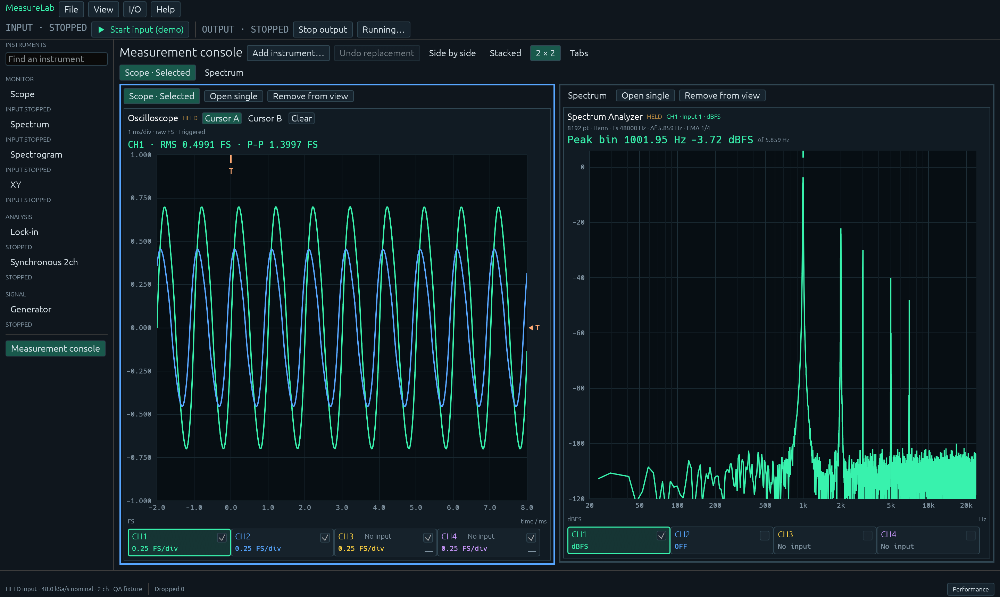
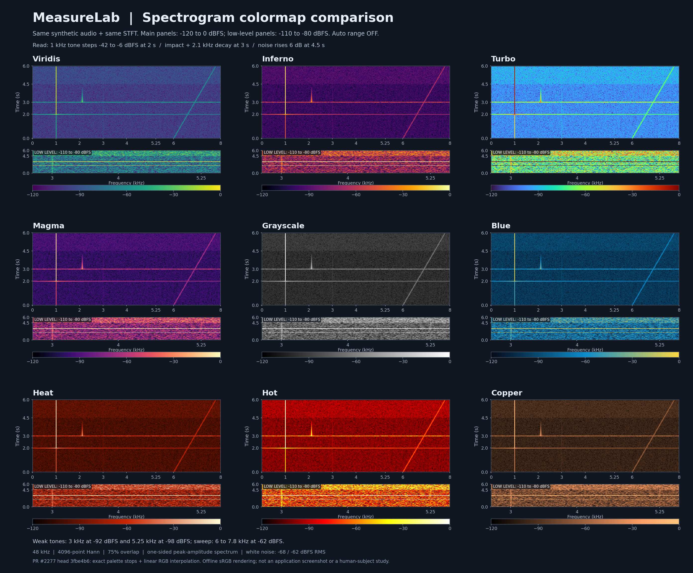

# Quick start

For binary installation, OS permissions and signing limits, see [Install a binary](install.md). Rust downloads remain unpublished during preparation.

## Build from source

Use a checkout containing the Rust edition and Rust 1.95 or later. The Rust edition is on `main`. macOS needs Xcode Command Line Tools; Linux needs ALSA, X11 and Wayland development libraries; Windows needs MSVC and Visual Studio C++ Build Tools. See `guide/rust/SETUP.md` in the repository for details.

Run from the repository root:

```sh
cargo run --release --locked
```

With the local macOS/Linux setup, `./scripts/cargo.sh run --release --locked` also works. Normal startup leaves acquisition stopped.

## First measurement without hardware

**I/O → Input / output** shows both connection directions on one page, side by side in wide windows and stacked in narrow windows. Input selects the source and device; Output selects the output device, channel count and PCM. Select a supported rate for both in **SAMPLE RATE · INPUT + OUTPUT** while stopped; **Refresh devices** refreshes both lists. Enable **Separate sample rates** to set rates independently. Signal settings, ON/OFF and OUT assignments remain on the Generator cards.

1. Select **Software Loopback** under **I/O → Input / output**. It is available in normal builds and does not drive a physical output.
2. Use **Back to instruments**, open **Scope**, choose **Pair with… / Spectrum**, then press **Start input**.
3. Click a pane to select its details. CH, time/amplitude scales, Autoset and cursors stay in the instrument; FFT/window/averaging settings are in the selected details. Start with the default 8,192-point FFT.
4. Press **Stop input** to hold results, then inspect cursors, RMS, peaks or PSD band values.
5. Use **File** to save settings and held results. JSON retains measurement conditions; CSV supports numerical reuse; PNG shares a view.
6. After restarting, restore settings while stopped, load the reference JSON, and compare a new measurement. Restoring settings does not start acquisition.



*Held synthetic input from the current QA build, showing Scope and Spectrum together. This illustrates the interface, not physical-device accuracy.*

A complete 524,288-point window takes about 10.92 seconds at 48 kHz. Faster Live updates do not shorten that observation time. Continuous analyzes every N/4-hop window; Live/Latest observe recent windows and do not guarantee transient capture.

Normal startup shows Scope alone, with input and output stopped. Selecting an instrument always opens its single view. **Measurement console / Add instrument…** retains up to seven instruments, using side-by-side, stacked, 2 × 2 or tabs. Narrow windows temporarily use tabs without changing the saved arrangement. **Open single** keeps the console for returning later. **Remove from view** leaves analysis and output running. The right details follow the selected pane; narrow windows use **Measurement / Details**. **Running…** shows hidden analysis and provides analysis stops; **Stop output** remains available on every screen. LIVE / HELD / WAITING / NOT ACQUIRED describe acquisition, separately from validity. Settings version 9 reads versions 1–8 and restores input/output stopped.

In Scope, select CH1–CH4 in the 40-point strip below the waveform, and use each checkbox to toggle its waveform independently. Selection and visibility are separate; CH3/CH4 show **No input** on a two-channel input. The right **Acquisition / Horizontal / Trigger / Channel** sections contain acquisition, time scale and position, trigger, and the selected channel's FS range and offset. The current time scale stays visible near the waveform. Use the wheel for time scale and Shift+wheel for the selected channel's vertical scale. **Channel / Input source** can assign any of the 1–16 input channels. Older settings preserve their two assignments and scales, with the added CH3/CH4 hidden.

Spectrum overlays up to four traces in one plot. The bottom channel bar selects a trace independently of its display toggle. The right details are ordered FFT → Frequency / Scale → Measurement → Averaging. Switch **Amplitude / PSD / Transient (ESD)** at the top and set the shared FFT conditions and axes. Expand **Custom frequency range** for precise bounds or select **Manual** for level limits. Only CH1 is visible by default.

**Transient (ESD)** measures energy spectral density and presets Rectangular, Average OFF and Remove DC OFF when selected. Fit the entire impact or decaying response inside one FFT window. Voltage-calibrated input uses a dB axis referenced to 1 V²·s/Hz; cursors and JSON/CSV also provide linear density. **Window energy** integrates all bins in V²·s. Other windows attenuate energy without correction; DC removal also changes energy. Averaging gives an EMA of window energies, not cumulative energy. Single-shot/trigger integration is not implemented; Live/Latest do not guarantee transient capture.

Select **Cursor A / B**, then click or drag on the plot to place two independent frequency cursors. They read the selected trace's nearest FFT bins and show Δf and ΔL; **Clear** removes them. **Average / Weight** near the bottom controls exponential averaging of linear power (EMA), with settling guidance. Processed-window counts are under **Advanced analysis / diagnostics**. Hidden traces stop FFT processing and start a fresh average when enabled. Peak/cursor readings and result exports follow the selected trace. For uncalibrated amplitude, a bin-centred 1 FS peak sine is 0 dBFS.

When additional measurement details exceed a console pane's height, scroll within that pane. The pane title and shared input/output status and stop controls remain outside the scroll area.

## Read time and frequency changes

Select **Spectrogram** and open **Details / Display** to choose a color map, set Min/Max in dBFS, or enable **Auto color range**. The initial settings are **Viridis, −120 to 0 dBFS, Auto OFF**. Restoring saved settings preserves the color map, range and Auto setting; older settings without a color map retain the previous Blue appearance. Editing Min/Max returns to Manual. The color bar shows the active range; these controls leave analysis and history intact.

The color maps appear in this order: **Viridis → Inferno → Turbo → Magma → Grayscale → Blue → Heat → Hot → Copper**. To inspect background noise or weak components, narrow the display range first. The comparison below uses both the normal −120 to 0 dBFS range and −110 to −80 dBFS. A color map alone cannot guarantee that components near the noise floor can be distinguished.



*AI-created explanatory comparison. Each main panel uses −120 to 0 dBFS; its low-level panel uses −110 to −80 dBFS, with Auto OFF. This is an offline illustration, not an application screenshot, a hardware measurement or a study establishing visibility.*

Wheel over the plot to zoom frequency; drag the background to pan frequency and time. Shift+wheel also scrolls time. Click to enter Hold and pin an actual FFT frame to time A/B. Acquisition continues during Hold; **Live** releases held history and time selections. Double-click resets frequency and returns to the newest end of the current mode. **Time Range** offers 5/10/30/60 seconds. Numerical history retains up to 120 seconds or 96 MiB; display reduction uses at most 512 rows and 1,024 columns. Actual retention and capacity limits are shown, with unavailable time left blank.

Choose **Pair with… / Spectrum** to overlay the selected time A/B frames. **Time A / Time B** selects the trace for peak and frequency cursor readings. This read-only source uses the original f64 values and captured interval, channel, sample rate and FFT conditions: uncalibrated FS/dBFS, without averaging. Missing selections and gaps show a reason. **Normal Spectrum**, Live, Undo or restarting input returns to ordinary Spectrum while preserving its settings, average and peak hold. History Spectrum export is unavailable; Scope-only exports remain available in File.

**Details / Analysis / FFT Overlap** offers 50/75 (default)/87.5%, with integer hops N/2, N/4 and N/8. Frequency and amplitude definitions stay the same. Higher overlap increases analysis load and shortens retention within the memory limit. Changing it during acquisition clears old history and linking, then waits for a complete window. Edits while stopped apply on the next Start. Older settings restore 75%.

Each row uses the complete N/Fs-second FFT window; rows are spaced hop/Fs seconds apart. Time A/B identifies the window endpoint and actual sample interval. Increasing overlap leaves window duration and frequency resolution unchanged.

If data fills only the top of the image, compare the retained duration in the heading with **Time Range**. A view longer than the available history leaves the bottom blank. Choose a shorter range to inspect retained history at a larger scale.

## Observe a Generator sine wave

1. Open **Generator**, then choose **Pair with… / Scope**. The two-channel internal output is available in normal builds.
2. Select **Waveform / Sine** and **OUT 1/2** on the central cards, enable **ON**, then enter frequency (Hz), amplitude (dBFS peak) and phase (lead, degrees). Enter or leaving the field applies an edit; Esc cancels it. Use **EDIT STEP** in the details to select a step for the ± buttons and arrow keys.
3. Select **I/O → Input / output → Generator loopback**, then press **Start output** and **Start input** separately. The settings preview and measured waveform are separate views.
4. Select **Generator**, then pair it with Spectrum/Lock-in to inspect analysis. Live edits transition amplitude and phase smoothly; Spectrum/Lock-in restart averaging and settling after the transition.
5. **Stop input** holds the measurement while output continues. **Stop output** stops generation; active input then receives new silent samples.

Use **+ Add signal** for up to 16 cards and **Duplicate / Remove / Up / Down** to manage them. Stable GEN IDs are independent of OUT and display order. Deleting or moving a card preserves other routes. Copies receive a new ID, remain OFF and take a free OUT, or stay unassigned. Outputs assigned to other cards, including OFF cards, cannot be selected. Change cards, waveform and routing while output is stopped.

Waveforms are Sine, Square, Triangle and Noise. Square/Triangle retain up to 16 odd harmonics below 0.45 Fs; the peak setting is an amplitude ceiling and RMS depends on frequency. Triangle starts at its positive peak at 0°. Noise is continuous uniform white noise with a reproducible seed; its frequency and phase fields retain their values but are disabled. Select a GEN heading to edit its seed and inspect applied details on the right. Sweep, synchronization/groups, linked channels, multiple outputs per source and Mix are not implemented.

The central panel keeps the existing three numerical controls and settings preview. Wide windows show cards in two columns; narrow windows offer card selection with GEN ID, OUT and ON/OFF visible. **Hide signal controls** shows summaries for all cards.

In the shared section of **I/O → Input / output**, select a common rate of 44.1, 48, 96 or 192 kHz while both input and output are stopped. Restoring settings also requires both to be stopped and leaves output OFF. Internal JSON/CSV results retain output conditions for the received intervals.

For audio-device output, select a destination, channel count and PCM in the Output section of **I/O → Input / output**, and a sample rate in the shared section while stopped, then assign OUT on the Generator cards. Unassigned outputs are silent. Choose the connected physical input in the Input section, then press **Start output** and **Start input** separately. **Generator loopback** uses the internal connection. Output notifications or stalled callbacks latch ERROR; use **Reset output (stays OFF)** and an explicit Start to recover. Settings retain the output identity and format and restore with output OFF.

External input and output use separate clocks; output transitions are not automatically mapped to input analysis windows. Wait for input settling after edits and use two actual input channels for synchronous REF and response in Lock-in. JSON/CSV results that observe an external Generator retain applied settings, output state, failures and up to 128 observed changes. Input Stop, Single completion or input failure freezes this evidence; later edits cannot change it. Input-window correspondence remains uncalibrated, so reference comparisons omit numerical differences. Host observation times are not DAC/ADC timestamps, and lost or evicted history is not reconstructed. Result format version 6 also reads versions 1–5. Output calibration and DAC/ADC latency remain unverified.

## Physical audio input

Select the input device and a supported sample rate, then press **Start input**. On macOS, allow microphone access for the application or terminal used to launch it. Channel count and available sample rates depend on the device. Scope waveform axes and triggers remain in FS even when numerical readouts use calibration.

On macOS, physical input and output request an audio buffer of about 20 ms within the device's supported range to leave room for stream initialization and scheduling. When supported, 48 kHz uses 1,024 frames, about 21.3 ms. Output edit and Stop response also depend on this buffer length. The selected sample rate, channel count, PCM and measurement units are preserved.

Changes to input, analysis or calibration while stopped apply to the next Start. Held results keep their original conditions. Changing input or restarting acquisition begins a new history without mixing old generations.

## Experimental Lock-in

Select **Lock-in**, supply REF and response with Software Loopback, set SIG/REF channels in the instrument, then press **Start analysis** and **Start input** separately. Set REF and filter conditions in the selected details. X/Y and R use peak units; positive phase means the response leads REF. Settling, lost REF and missing input are not valid measurements. Hardware validation remains incomplete.

After Stop finishes processing, use **File** to save Lock-in conditions, calibrations, state and f64 values as JSON or CSV. Invalid readings use JSON `null` or empty CSV cells. Reference comparison shows both results and their captured conditions; numerical differences require settled results with matching nominal sample rate, channels, REF/filter settings and calibrations. PNG displays Scope/Spectrum.

## Compare synchronous gain, phase and delay

1. Supply two synchronous channels with Software Loopback or a real input, then select **Synchronous 2ch**.
2. Select different REF/SIG channels in the instrument, then press **Start analysis** and **Start input** separately. Set window and averaging in the selected details. The default 4,096 samples × 8 windows needs about 0.683 seconds at 48 kHz.
3. Use **Read at** or click a graph to select a frequency bin. Positive phase leads REF; positive delay lags REF. Low reference, low coherence and missing data suppress readings.
4. Stop, save JSON/CSV, restore settings while stopped and remeasure. Restoration starts neither input nor output. Reference differences require matching valid input, analysis, calibration and excitation conditions.

**Display range** offers the selected point neighborhood (default), the valid band, the full Nyquist range or a custom range, with linear or logarithmic frequency axes. These controls affect display only. Primary readings are shown separately; hover details and JSON/CSV retain f64 precision.

This f64 AC comparison removes each window's mean, averages auto/cross PSD over finite nonoverlapping windows, then computes H1 and coherence. Phase delay is ambiguous by 1/f. A slope fit requires at least eight contiguous sufficiently excited, coherent bins; a single sine does not establish broadband delay. The input clock is nominal; interchannel phase/timing calibration and absolute DAC/ADC latency remain unverified. PNG displays Scope/Spectrum.

See the [overview](index.md) for verification limits and unimplemented features.
