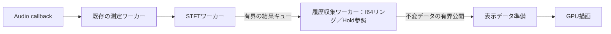

# Spectrogram MVP 改善計画

## 目的と位置づけ

既存のSpectrogramを、信号のレベル・周波数・時間変化を読み取り、測定を継続したまま過去のFFTを確認できる計器へ改善する。表示の美しさ、測定の正確さ、操作の直感性を重視し、左の計器選択・中央のプロット・右の設定という構成を維持する。

**S1〜S6のMVP基本受け入れを完了。** ④は履歴の時間A／Bを読み取り専用Spectrumへ接続し、⑤は50／75／87.5%の整数hopと設定版8への保存・旧版移行を扱う。S6は数値・容量・GPU・実ウィジェットと短時間の実時間比較を受け入れ範囲とする。他の高負荷操作への耐性、通常ビルドの包括的な手動操作、実モニター間DPIは追加確認として残す。

[現在の方針](../CURRENT_DIRECTION.md) の測定上の不変条件と、[PLAN](PLAN.md) のGUI基本操作の受け入れ・Generator／同期2ch比較の統合評価を維持する。GUI再構成G4の通常ビルド・実モニター間DPIの受け入れは残る。S1・S2の自動検証と通常ビルドの手動受け入れを区別し、実装をリリース完了とは扱わない。

## 現状と変更範囲

| 対象 | 現在の実装 | 今回の変更 |
| --- | --- | --- |
| 色 | 共通色定義のカラーバー、Turbo／Viridis／Inferno／Magma／Grayscale／Hot／Copperと既存のBlue／Heat、Min／Max／Auto | Hold・表示要求経路へAutoを接続済み |
| 表示範囲 | Log／Linear、From／To、ホイールズーム・横パン、5／10／30／60秒、ダブルクリックリセット | 縦パン・時間スクロールを実装。旧時間幅は復元値として維持 |
| 履歴 | 数値履歴は120秒・96 MiBの有界リング。表示は最大512行・1,024列へ縮約し最新が上 | Live／Hold・過去への移動、容量・基本実時間比較を確認。高負荷耐性は継続課題 |
| 保存データ | f64線形スペクトルと入力／解析世代、整数サンプル区間・設定・欠落。描画用f32 dBは別キャッシュ | 不変スナップショットをHold・実フレーム選択へ接続済み |
| 実行 | STFT・履歴収集・表示準備は独立ワーカー。UIは有界公開された表示データを受信 | 変換・Autoを表示準備へ移し、古い要求・応答を置換／排除 |
| 時間カーソル | A／Bは整数サンプルと元のf64フレームを保持 | 履歴を選ぶとHoldへ移り実フレームへ固定し、Spectrumへ接続 |
| Spectrumとの関係 | 周波数カーソルを共有。履歴表示では時間選択と独立 | SpectrogramからSpectrumをペアにしたとき、選択した時間A／Bを連携 |
| Overlap | 列挙型から整数hopを生成 | 50／75／87.5%。既定75%、各行の実サンプル位置を維持 |

STFTは独立した1,024〜32,768点、既定f64、単一入力CHのビン振幅を維持する。Spectrumの最大524,288点、4ch表示、PSD／ESD・校正・平均をSpectrogramへ移植しない。入力1〜16chからのSource選択は維持する。

## 現在の実装と受け入れ範囲

表示設定とOverlapは設定版8へ保存し、版1〜7の読み込みを維持する。旧設定のOverlapは75%とする。数値の正本は`stft::Row::power()`と`spectrogram::history`のf64線形値に移した。無音の0と無効フレームのNaNを区別し、f32 dBから精密値を復元しない。履歴は実サンプル区間・入力世代・解析世代を保持し、120秒または96 MiBで古い行から退役する。独立した収集ワーカーが結果プールを回収し、UI受信停止中も保持を継続する。不変スナップショットは周回後も値を保持し、通常退役と容量不足による結果欠落を分ける。

GUIからの表示要求と応答は各1件とし、パン・ズームの古い要求は置換する。表示準備ワーカーが不変履歴から最大512行・1,024列の描画用ラスタとAuto統計を作り、UIは要求ID・入力／解析世代を照合して適用する。多数のフレームを縮約するときは、表示行ごとにf64線形値の最大を集めてからdBへ変換し、全フレームの反復変換を避ける。追加のf64作業領域は表示1行分に限定し、微小値・無効値を維持する。長時間表示では時間・周波数のピークを残し、縮約行に欠落がある場合は縞を併記する。カーソル・ホバーは縮約画素を測定値に使わず、元の実フレームを検索する。色・Manualレンジだけの変更は再変換・再転送せず、同じ内容のラスタ行も再転送しない。

Live／Hold、背景の縦パン、Shift＋ホイール／時間軸ホイール、実フレーム選択・線ドラッグ、現在モード内の最新端へのリセットを接続した。ダブルクリックとの競合を避けるため単クリックの選択を判定待ちにする。Holdは表示中の履歴を固定し、収集と最新履歴は更新を続ける。Live復帰はHoldと時間A／Bを解放し、入力停止中は入力を開始しない。入力再開・取得中の解析条件変更で旧世代の表示・選択を解除する。

数値フレームの参照を含む合計容量を192 MiB、表示ラスタの処理中・応答・表示中の合計を8 MiBの予約で制限する。描画キャッシュは要求サイズに応じて確保する。CPU合計224 MiBは`tests/spectrogram_capacity.rs`の独立プロセスでFFT・結果プール・履歴・Hold・表示準備の確保要求を合算し、周回・旧新世代交換・終了時解放を判定する。GPU32 MiBは最大ラスタと反復リサイズ時の旧新テクスチャpayloadを`--gpu-smoke`で判定する。確保payloadとアロケーター管理費用・RSS・GPUドライバー使用量を区別し、自動容量試験を実時間・手動操作の受け入れへ代用しない。

履歴周回・最大N／高Fs・参照解放・世代変更・UI受信停止は`spectrogram/history.rs`、ピーク・欠落の縮約、固定上端、大きなサンプル番号、有界キャッシュと表示要求は`spectrogram/viewport.rs`を入口とする。GPU読み戻しは従来の色・生ビンに加え、新しいラスタ経路のDC／Nyquistと転送省略を扱う。GUI QAはHold／Live、固定フレーム、縦パン・時間ホイールとダブルクリックを扱う。実時間の収集継続は既存`MEASURELAB_PROFILE_UI_STALL`で確認する。

実時間比較は`MEASURELAB_PROFILE_SPECTROGRAM=live`／`stress`で同一条件の基準表示と反復操作を選ぶ。内部の既知正弦波、Software Loopback、通常Generatorの内部入力、BlackHole 2ch／16ch、UAC-232で、表示準備時間・要求応答・GPU転送、UI停止中の収集継続・STFTの世代不変・欠落を判定する。基本条件の物理I/Oは48 kHz、高Fsは内部経路とBlackHole 16chで扱う。保持した生入力からの独立DFTと、整数hop・予定窓数・元のf64 Spectrum読出しを照合する。Software Loopback／Generator開始時にSTFTが停止したままになる不具合も修正した。再現コマンドは[VALIDATION](VALIDATION.md#spectrogramの容量比較負荷)、条件・数値・操作応答の正本はテスト／QAコードに置く。

MVPの基本検証と長時間・他の高負荷操作への耐性を分ける。撮影操作が重なった長時間評価ではGUI更新の長い停止、STFT転送・Generator内部入力の欠落を観測した。UAC-232の192 kHz起動時にもSTFT転送欠落が再現し、原因切り分けと耐性改善を残す。短時間の成功をこれらの条件の保証に広げない。単独／Pair・通常幅／狭幅の実ウィジェット操作と画像は確認したが、通常ビルドの包括的な手動操作と実モニター間DPIは未確認。長い時間幅・高Overlapでは、入力／解析欠落と表示の追従遅延を別に扱う。

## UIと操作仕様

### 配置

| 場所 | 項目と順序 |
| --- | --- |
| 中央プロット上部 | Source、Live／Hold、Cursor A／B、Pair with… |
| プロット右端 | 細いカラーバー、dBFS、Min／Maxと中間目盛 |
| 右サイドバー・Display | Color Map、Color Range（Min／Max／Auto）、Frequency Scale（Log／Linear）、Time Range |
| 右サイドバー・Analysis | FFT Precision、FFT Length、FFT Overlap、Window、Remove DC Offset |
| プロット付近の既存情報欄 | 表示基準時刻、保持できている秒数、必要時のみ欠落・履歴上限の状態 |

現在の上部`Display…`メニューは右側Displayへ統合する。周波数のFrom／ToはFrequency Scale内の範囲編集として維持する。`Pair with…`は既存の共通枠と共有し、同じ画面へ二重に置かない。カーソル解除は既存のClearを再利用する。解析条件の説明は短い情報欄とホバーへまとめる。

狭幅は既存のDetails退避・折り返し・コンソールのタブを使う。Source、表示状態、カーソル、単位を見失わず、カラーバーがプロットを過度に狭めないことを確認する。

### 色とAuto Range

* 新規設定の既定はBlue、Manual、Min = −120 dBFS、Max = 0 dBFS。Blueは既存の色対応を継承する。Heatは暗部から暖色・明部へ、Grayscaleは暗部から白へ単調に変化させる。
* Min／Maxは有限値かつMin < Maxとし、不正入力は直前の有効値を維持して示す。数値データ自体を表示レンジで切り詰めない。
* Autoは有効／無効を切り替える継続モード。表示中の時間・周波数範囲にある有効なビンを対象とし、下限はノイズ床側の分位点、上限は最大値に余裕を加えて求める。単発の強いピークも含める。
* Liveでは更新頻度を制限し、平滑化とヒステリシスで目盛のちらつきを抑える。Holdでは同じ範囲に対して値を固定し、パン・ズームで対象範囲が変わったときだけ更新する。Min／Maxの手動編集でManualへ戻る。
* 欠落、未取得、非有限値は統計から除外する。無音・有効データ不足では最後の有効レンジ、未確定なら既定レンジを使い、ゼロ幅やNaNを生成しない。分位点・余裕幅・平滑化の具体値は実装時にコードとテストを正本として決める。
* カラーバーと画像は同じ色定義・正規化を使用する。欠落の縞模様、未取得の空白、無音・表示下限以下の色は区別する。
* 色・レンジ変更は表示パラメーターだけを更新する。Autoも保存済みスペクトルから計算し、FFT実行・履歴リセット・入力世代の変更を発生させない。

### ズーム、パン、選択の競合解消

横軸は低周波が左・高周波が右、縦軸は新しい時刻が上・古い時刻が下を維持する。時間幅は5／10／30／60秒、既定5秒。周波数は既定Logとし、LinearはDCを含み、Logは正の下限からNyquistまでを扱う。

| 操作 | 動作 |
| --- | --- |
| プロット上でホイール | ポインターの周波数を中心に横軸ズーム。Logでは対数座標で処理 |
| 背景をドラッグ | 横方向は周波数パン、縦方向は履歴パン。ドラッグ判定後はカーソルを新設しない |
| Shift＋ホイール／時間軸上のホイール | 過去・新しい側へ時間スクロール。通常の周波数ズームと分離 |
| プロットをクリック | 選択中の時間Cursor A／Bを配置。LiveならHoldへ入り、そのフレームを固定 |
| 既存の時間カーソル線をドラッグ | 同じカーソルを別のフレームへ移動。背景パンより優先 |
| Time Rangeを変更 | 時間幅を変更。Liveは最新端、Holdは固定した表示上端を基準にする |
| ダブルクリック | 周波数を全体表示へ、時間位置を現在モードの最新端へ戻す。選択したTime RangeとLive／Holdは維持 |

ダブルクリックは単クリック選択より優先し、意図せずHoldへ切り替えない。周波数の全体表示はLinearで0〜Nyquist、Logで既定下限20 Hz〜Nyquistとし、Fs・FFTに応じて有効範囲へ制限する。ズーム下限・境界では有効なビン範囲を維持する。

時間方向へ移動し始めたときにLiveからHoldへ切り替える。横方向だけの操作はLiveを維持する。ホイールはプロット内でのみ消費し、右サイドバーのスクロールを妨げない。操作説明はホバーと既存Helpへ置く。

### Live／Holdと履歴の寿命

| 状態・イベント | 契約 |
| --- | --- |
| Live | 保存された最新の完全FFTフレームへ表示を追従する |
| Hold | その時点の保持履歴を不変のスナップショットとして参照。入力・STFT・最新履歴の更新は継続 |
| Hold内のスクロール | 固定した履歴の範囲内を閲覧。後から取得したデータは混ぜない |
| Liveへ戻る | Hold履歴と時間A／B選択を解放し、最新データへ戻る。連携Spectrumも通常表示へ戻す |
| 共通Stop／Single完了／入力失敗 | 最新履歴を停止境界で固定し、遅着結果を除外する。既にHold中の表示スナップショットは維持 |
| 入力停止中のLive操作 | 入力を開始せず、停止時の最新履歴を表示する。入力停止の状態表示を残す |
| 入力の再開／入力ソース・デバイスの切り替え | 旧世代の履歴、Hold、時間カーソル、連携を無効化し、新しい完全窓を待つ |
| 取得中のSource／FFT条件変更 | 新しい解析世代へ切り替え、旧履歴・Hold・連携を解除する。実際のFs変更は入力世代も更新 |
| 入力停止中のSource／FFT条件編集 | 次回Start用の設定として保持。保存済み履歴の条件・単位を変更しない |

Hold中の無操作では画像・時刻・Autoレンジを変えない。色・範囲の明示操作は許可する。共通入力のRUNNING／STOPPEDとSpectrogramのLive／Holdを別の状態として表示し、Holdを入力停止と誤認させない。

## データと実行の設計

### 履歴の正本

`stft::RowInfo`を基盤に、入力世代と解析世代、Source、Fs、FFT長、hop、Window、DC除去、Precision、実サンプル区間`[start, end)`、欠落・有効性を追跡する。現在のSTFT世代と共通入力世代は混同せず、両者の対応を保持する。

フレームには`N/2 + 1`個のf64線形値を保持する。既存`Analyzer::power()`の振幅二乗を正本として使い、読み値は平方根と`10 log10(power)`から求める。f32 FFT選択時も正規化・線形値の保持は既存Spectrumと同じf64とし、FFT自体の精度はメタデータに残す。

* f32 dB配列は描画用キャッシュとし、精密なSpectrum読み値へ逆算しない。全履歴にf64と描画用配列を二重保持しない。
* 振幅の窓補正、DC／Nyquist、DC除去は既存Spectrumの計算を共用する。無音の線形値0と数値上の−∞ dBを、未取得・欠落・非有限値と区別する。
* Spectrogramの単位は未校正FS／dBFS。連携後もその条件を維持し、現在のSpectrumの校正を後付けしない。
* フレーム識別は世代と整数窓区間で行う。循環配列のslot番号を永続的なカーソルIDにしない。
* 全入力波形や複素FFTは保持しない。今回必要な過去の振幅スペクトラムに範囲を限定する。

### 時間・周波数の座標

FFT窓全体は`[start, end)`、表示する一行は現在と同じ`[end - hop, end)`に対応する。時刻の代表は窓終端であり、時間分解能をhopだけで説明しない。FFT窓時間`N/Fs`、行間隔`hop/Fs`、ビン間隔`Fs/N`を区別する。

表示上端を整数サンプル位置`anchor_end`として、行の上端を`(anchor_end - end) / Fs`で配置する。Liveは最新フレーム、Holdは固定スナップショット内の表示位置から基準を決める。差分は符号付きで安全に計算できる整数型で求めてからf64へ変換し、画面外の新しい行での減算アンダーフローと、長時間運転での精度落ちを避ける。

カーソル・ホバーは表示中のhop区間を検索する。欠落に重なる別のFFT窓や隣の行を代用しない。画像の目盛、パン、選択、Spectrumに渡す区間は同じ座標変換を使う。

### FFT、履歴収集、描画の分離

STFTの結果回収を`app.rs`のUI更新から履歴収集側へ移す。取得・測定・FFTはUI／GPUのロックや描画完了を待たない。既存の有界キュー・世代管理・結果公開の実装パターンを再利用し、音声コールバックの責務は増やさない。

* 履歴は固定容量のリングとして管理し、容量確保・解放は音声コールバック外で行う。Holdは不変フレームへの参照を固定し、画面更新ごとの全履歴コピーを避ける。
* Hold用参照があるフレームを上書きしない。最新履歴とHoldの予算を分け、最新側が周回してもHold画像・数値を維持する。Holdは最大1組、置き換え・解除時に古い参照を解放する。
* 表示要求と応答は有界とし、連続パン・ズームでは古い要求を置き換える。要求ID・世代の違う遅着応答は適用しない。重い変換・Auto統計・GPU転送中に履歴書き込み用ロックを保持しない。
* UI停止中も履歴回収を継続する。表示更新を省いた回数、結果転送の欠落、入力欠落、保持上限による通常の退役を別に数える。
* 過負荷時は待機せず、失った区間を既存の欠落メタデータへ伝える。履歴外は空白、欠落は縞として実時間上に残す。ゼロ埋め・時間圧縮をしない。
* 共通Stop・入力再開は履歴収集側にも伝え、停止境界と世代を確定する。表示のHoldで`Worker::pause()`や共通Stopを呼ばない。

### 保持上限とGPUキャッシュ

初期の設計予算は次表とする。実装時に定数・容量計算・上限テストへ落とし込み、実測で変更する場合はこの設計も更新する。上限はSpectrogramに帰属するデータ容量であり、アプリ全体のRSSやGPUドライバーの使用量とは区別する。

| 項目 | 上限案 | 管理方法 |
| --- | --- | --- |
| 最新の数値履歴 | 120秒かつ96 MiB | 先に達した上限で古い行から退役 |
| Hold履歴 | 1スナップショット、96 MiB | 固定時点の保持範囲を共有参照。最新履歴との共有分は実消費で一度だけ数える |
| CPUの演算作業領域・転送・表示キャッシュ | 合計32 MiB | FFT作業領域、結果プール、選択A／B、変換用バッファ、公開データ等も制限 |
| GPU表示キャッシュ | 合計32 MiB | 可視範囲のタイル／行と描画用バッファを制限。全履歴分の巨大テクスチャは作らない |

最新・Holdの各予算にはフレーム情報と所有権管理の実コストを含める。CPUは合計224 MiB以内、GPUは32 MiB以内をデータ容量の上限とし、必要量に応じて確保する。設定変更・キャッシュ交換時に旧新両方が生存するピークも予算内に含め、反復Holdで増え続けないようにする。

欠落のない履歴に必要な行数は概ね`ceil(retention_seconds × Fs / hop)`、各行の主な容量は`8 × (N/2 + 1)`バイトとなる。たとえば48 kHz・8,192点の60秒は、75%で約44 MiB、87.5%で約88 MiBの線形値を要する。これは設計上の概算であり、実測メモリではない。96 MiBの予算では、より高いFsで60秒に満たない場合がある。

**Time Rangeは表示幅、保持時間は利用可能なデータ量として別に扱う。** 60秒を選べても不足分を補完しない。実際の保持秒数と容量による制限を既存情報欄に表示する。設定を変えずに保持時間だけを延ばすためのFFT間引きは行わない。

GPUは必要な行だけをキャッシュし、同じ行の再転送を避ける。長い時間幅で行数が描画画素を超える場合は、表示用の縮約で強いビンと欠落を失わないようにする。縮約した画素を時間平均した測定結果として扱わず、カーソルは常に元のf64フレームを選ぶ。拡大すると元の時間・周波数構造を再表示できることを条件にする。

## Spectrum連動

Spectrogramの`Pair with… → Spectrum`で既存の2計器配置を開き、履歴選択の連携を有効にする。コンソール構成置換の表示・Undoは既存の契約を維持する。他の計器とのPairや既存レイアウトを開くだけの操作では、Spectrumのデータ源を勝手に変更しない。

* 時間Cursor A／Bは選択時点の実フレームを保持し、対応する水平ラインを表示する。選択した窓区間、CH、Fs、FFT条件、Δtを確認できるようにする。パンで画面外へ出ても時刻を別フレームへ置き換えない。
* 連携Spectrumでは選択したA／Bの最大2本を重ね、`Time A`／`Time B`と取得時刻を示す。既存のSpectrumプロット、周波数軸、ピーク・周波数カーソルの読み出しを再利用する。
* 時間A／BとSpectrumの周波数A／Bは別の状態とする。既存`cursor.rs`のScope／XY時間カーソルの追従仕様は変更しない。共通入力世代を照合した上で、必要な整数サンプル参照だけを共有する。
* 保存済みf64線形値を読み取り専用のSpectrumデータ源へ接続する。FFT・生入力読出し・平均の更新は行わない。`spectrum::Result`への変換か共通の読み取りインターフェースを使い、正規化と数値読み出しを二重実装しない。
* 履歴表示中のSpectrumはBin amplitude・FS／dBFS・平均なしの取得時条件を明示する。FFT・Source・PSD／ESD・平均・校正の編集を履歴へ適用せず、必要な欄を取得時条件の読み取り専用表示にする。
* 通常SpectrumのCH表示、選択、FFT条件、平均・保持、校正、解析ワーカーの実行状態を保持する。履歴表示の終了で通常表示へ戻し、平均をリセットしない。
* 対象なし・欠落・無効フレームでは理由を表示し、最新Spectrumや隣の行で埋めない。連携解除、PairのUndo、入力世代変更、Live復帰時の表示状態を明示的に扱う。
* 今回は履歴スペクトルのJSON／CSV／PNG出力を追加しない。履歴表示中にSpectrumの既存出力を操作して別の通常測定結果を書き出さないよう、該当出力を理由付きで無効化する。Scopeの出力は維持する。

時間カーソルは実フレーム選択を使い、Spectrumへの経路は`Result::from_stft`で既存の数値読出し・描画を再利用する。`Time A`／`Time B`で読出し対象を選ぶ。`Normal Spectrum`、Live、PairのUndo、単独表示への移動、対象区画の除去、入力／解析世代変更で一時データ源を解除する。同じコンソール内では`Time A/B from Spectrogram`で明示的に再接続できる。Scopeのみの出力は既存の結果形式でSpectrumをUnavailableとして維持する。

## FFT Overlap

| 表示値 | hop | 備考 |
| --- | --- | --- |
| 50% | `N/2` | 解析回数・履歴の生成量が少ない |
| 75% | `N/4` | 現在と同じ既定値 |
| 87.5% | `N/8` | 同じN・Fsで75%の2倍の解析回数・履歴生成量 |

Overlapは浮動小数の割合から毎回丸めず、列挙型から整数hopを生成する。`stft::Config`の検証とサンプル時計による窓生成を再利用し、アプリ・QA・保持時間表示の`N/4`固定を更新する。Spectrum側のContinuousモードのhopは変更しない。

変更はSpectrogramの解析世代を切り替え、古い行を混ぜず、新しい完全窓を待つ。時間座標は各行の実際の`start`／`end`／`hop`から求める。行番号、UI時刻、設定中のOverlapから過去の時刻を推定しない。周波数の定義・窓補正・ビン振幅はOverlapで変えない。

## 設定保存と互換性

* Display設定（色、Manualレンジ、Auto、周波数軸・範囲、Time Range）はWorkspaceへ、OverlapはSpectrogramの解析設定へ置く。
* 表示設定とOverlapは版8で保存し、版1〜7の読込を維持する。新フィールドがない場合はBlue・Manualを補う。Overlapは版8の解析設定へ追加済みで、旧設定は75%を補う。既存の色レンジ・Source・FFT設定・表示軸を保つ。
* 旧設定の0.5／1／2／20秒はそのまま復元し、その値を読込値として表示する。新しく選ぶ標準プリセットは5／10／30／60秒とする。旧ファイルを読込だけで書き換えない。
* Holdの実データ、実行中のカーソル、過去時刻へのパン位置、Spectrumの一時的な履歴データ源は保存しない。復元で入出力を開始せず、次回StartからLiveを開始する。
* 表示設定の変更で測定設定の再送・世代更新が起きないことを検証する。結果ファイルの形式や`version.json`は本機能の計画だけでは変更しない。

## 実装工程と完了ゲート

| 工程 | 実装する内容 | 主な変更箇所 | 次へ進む条件 |
| --- | --- | --- | --- |
| S0：契約と比較基準 | 実行・時刻・容量・操作の契約を確認し、既存負荷を計測 | `stft.rs`、`spectrogram.rs`、`qa.rs`、`benches/` | 計測条件と比較対象が再現でき、UIと解析の依存箇所を特定できる |
| S1：①カラースケール | 共通色定義、カラーバー、3色、Min／Max／Auto、右側Displayへの移動 | `spectrogram_gpu.rs`、`spectrogram.wgsl`、`app.rs`、`app/monitor_controls.rs`、`app/shell.rs`、`settings.rs` | 色対応・数値目盛が一致し、操作でFFT／履歴が変化しない |
| S2：②ズーム・表示範囲 | 共通座標モデル、ズーム・横パン、Time Range、リセット | `spectrogram.rs`、`app.rs`、`cursor.rs`、GPU描画 | 軸・ホバーが一致し、既存カーソルとの入力競合がない。512行による不足は明示 |
| S3：③履歴操作 | f64履歴、有界収集、表示キャッシュ、Live／Hold、縦パン、固定時間カーソル | `stft.rs`、`spectrogram.rs`、必要な履歴収集モジュール、`spectrogram_gpu.rs`、`app.rs`、`cursor.rs` | UI停止中も履歴が更新され、Holdが周回で変化せず、上限内で最新へ戻れる |
| S4：④Spectrum連動 | Pair時の連携状態、時間A／Bの2本表示、既存数値読出しの再利用 | `app/shell.rs`、`presentation.rs`、`app/spectrum_controls.rs`、`spectrum.rs`、`app.rs`、`cursor.rs` | 任意の有効フレームを元のf64値で読め、通常Spectrumへ副作用なく戻れる |
| S5：⑤Overlap | 3段階の設定、整数hop、世代更新、保存移行 | `stft.rs`、`app.rs`、`settings.rs`、`qa.rs` | 3設定で実サンプル時刻・振幅・周波数が正しく、負荷と保持上限を満たす |
| S6：統合受け入れ | 反復操作、性能・数値・画像確認、現行文書の更新 | `app/gui_qa.rs`、`gpu.rs`、`qa/spectrogram.rs`、`scripts/qa_spectrogram.py`、`guide/rust/`、`docs-rust/` | MVP基本受け入れ完了。高負荷耐性・追加手動確認・実モニター間DPIは別に残す |

S1・S2は既存履歴のまま進められる。S2で時間幅の選択は追加するが、長時間保持と時間スクロールの完成はS3で判定する。S3の履歴基盤、S4のSpectrum連携、S5のOverlapの自動検証と、S6の実時間比較を分ける。共通処理は必要な範囲で抽出し、アプリ全体の描画方式や汎用解析グラフの再設計は行わない。

## 検証計画

以下は検証の範囲。具体的な条件・許容差・性能判定はテスト／QAコードを正本とし、限定した実機確認と残る制限は[VALIDATION](VALIDATION.md)へ記載する。

| 検証対象 | 主なケース | 入口 |
| --- | --- | --- |
| 色とAuto | 既知のdB値とカラーバーの一致、3色、無音、強弱混在、ピーク、欠落、非有限、手動への復帰 | `spectrogram.rs`、`gpu.rs` |
| 表示と演算の独立 | 色・軸・時間幅・パン・Hold操作でFFT設定／世代・履歴値を変更しない。一定入力区間当たりのFFT回数が表示操作に依存しない | `stft.rs`、`app/gui_qa.rs`、`qa.rs` |
| 時間・周波数 | 全STFT長と3 Overlap、ビン中心の正弦波、DC／Nyquist、長い整数サンプル番号、窓充填・入力欠落・結果欠落 | `stft.rs`、`spectrogram.rs`、`qa/spectrogram.rs`の独立DFT |
| 保持・容量 | 120秒相当以上の周回、最大N・高Fs、Holdのまま周回、連続Hold／Live、設定変更時のピーク容量、取得前・履歴不足 | 履歴単体テスト、`qa.rs` |
| 実行分離 | UI受信停止・非表示中も履歴収集が進む。GPU遅延・表示要求飽和で測定側が待たず、欠落の種別が正しい | 履歴ワーカーのテスト、`scripts/qa_spectrogram.py` |
| カーソル・連携 | A／B固定、画面外、欠落、同一フレーム、Source変更、通常Spectrumとの往復、周波数A／Bとの独立 | `cursor.rs`、`spectrum.rs`、`app/gui_qa.rs` |
| 状態と設定 | Stop・Single・失敗・再開、遅着排除、旧版移行・新設定往復、通常Spectrumの平均・校正・表示状態の保存 | `settings.rs`、`measurement.rs`、GUI QA |
| GPU | 変更行だけの転送、色変更で不要な再転送なし、縮約時のピーク／欠落、Log境界、最大NのNyquist | `gpu.rs`の読み戻し |
| 操作と見た目 | ホイール・パン・クリックの競合、カラーバー可読性、通常幅・狭幅・DPI、単独／Pair／コンソール・Undo | `app/gui_qa.rs`と通常ビルドの手動確認 |

S0で同一機器・Fs・FFT長・精度・表示寸法の基準を取り、S3／S5でUIフレーム時間、STFT処理時間、入力／解析欠落、表示省略、CPUデータ容量・RSS、GPU転送量を比較する。自動の有限入力試験と実時間試験を分け、既存の48 kHz条件に加え、利用可能な高Fs・1〜16ch入力からの選択を確認する。全CHのSTFTを常時動かさない。

Overlapで増える本来のFFT回数と、UI操作による余分な演算を区別する。表示操作の反復で取得欠落を増やさず、対応する負荷条件で必要な解析が追いつくことを受け入れ基準にする。性能基準を満たさない場合は表示側の処理量・転送量を先に改善し、黙ってFFTを間引かない。内部入力、Software Loopback、利用可能な外部I/Oの結果は別々に扱う。

Rust変更時の共通検証は [Tool Usage Guide](../../.agents/workflows/tool_usage.md) に従い、fmt、全ターゲット・全機能Clippy／テスト、GUIなし・通常テスト、docテスト、releaseビルドを行う。反復性能計測は必要な工程で`cargo bench`を明示的に実行する。各変更後にMarkdown lintとRuff、公開マニュアル更新時にMkDocsビルドを行う。操作の正本は実装に合わせて[README](README.md)、テスト入口・限定した実機確認は[VALIDATION](VALIDATION.md)、未完了条件は[PLAN](PLAN.md)へ反映する。

## 最終完了条件と対象外

1. Turbo／Viridis／Inferno／Magma／Grayscale／Hot／Copperと既存のBlue／Heat、Min／Max／Auto、カラーバーを使え、色・範囲操作でFFTを再実行しない。
2. Log／Linear、ホイールズーム、パン、5／10／30／60秒、ダブルクリックリセットを使え、軸・ホバー・選択時刻が一致する。
3. 入力・測定を止めずにHoldと過去のスクロールを使え、履歴周回後も保持表示が変わらず、Live復帰で最新を表示する。保持範囲と容量制限を確認できる。
4. 保持範囲内の任意の有効時刻をA／Bで選び、PairしたSpectrumで元のFFTの周波数・f64レベルを確認できる。
5. 50／75／87.5%で実サンプル位置による時間軸と既存の周波数・振幅定義を維持する。
6. 通常Spectrum、他の計器、共通入力停止、設定復元の挙動を維持し、上限内のメモリ・既定条件の測定性能・狭幅での可読性を確認する。

周波数マスクトリガー、自動イベント検出、Wavelet／CWT、3D表示、高度な録画・再生は対象外。履歴のファイル保存、複数CHの同時Spectrogram、過去フレームの別窓／別FFT長での再解析、Spectrogramへの物理校正・PSD／ESD追加も後続とする。
